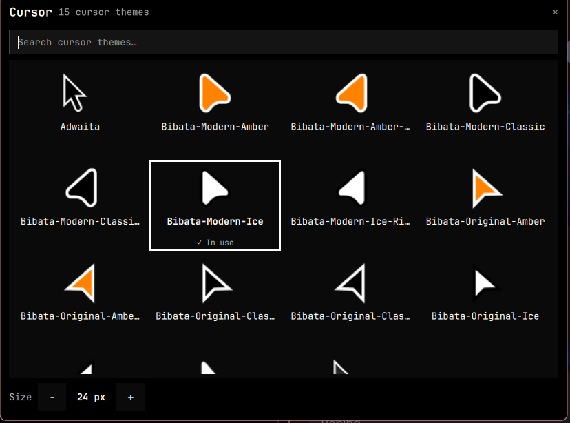

# Cursor Picker

An Omarchy shell plugin to choose the mouse cursor from the cursor themes you
have installed, with a preview of each one, and apply it instantly.



- Finds every theme with a `cursors/` folder in `~/.icons`, `~/.local/share/icons`
  and the system icon directories.
- Searchable grid; click a theme to apply it at once, no restart.
- Size control (16–96 px).
- Your choice is saved and re-applied each time the shell starts.
- A bar button opens the panel; you can also bind the IPC command to a key.
- Follows the Omarchy theme and language (English and Spanish included).

## Install

```bash
omarchy plugin add https://github.com/ShadowPJ/omarchy-cursor-picker.git --enable
```

For development, link a checkout:

```bash
ln -sfn "$PWD" ~/.config/omarchy/plugins/shadowpj.cursorpicker
omarchy-shell shell rescanPlugins
omarchy plugin enable shadowpj.cursorpicker
```

## Use

```bash
omarchy-shell shadowpj.cursorpicker panel        # open / close the picker
omarchy-shell shadowpj.cursorpicker set Adwaita  # apply a theme by id
omarchy-shell shadowpj.cursorpicker size 32      # change the size
omarchy-shell shadowpj.cursorpicker refresh      # rescan installed themes
```

Bind `panel` to a key in your Hyprland config to open it quickly.

The plugin also ships a bar widget (a cursor icon). Add it with
`omarchy bar put shadowpj.cursorpicker --section right`, or let `--enable` place
it. It works as a plain bar widget and inside bar-drawer plugins such as
[Pocket](https://github.com/jrmmhm/omarchy-pocket); it was not usable inside Den
or Tray on Omarchy 4.5.

## How it applies a cursor

`hyprctl setcursor <theme> <size>` for Hyprland and Xwayland apps, plus the
`org.gnome.desktop.interface` `cursor-theme` / `cursor-size` settings for GTK
apps. The choice lives in `~/.config/omarchy/cursor-picker.json` and is
re-applied three seconds after the shell starts, so it wins over the
`hyprctl setcursor` line in `hyprland.conf`. Delete the file to stop that.

Previews are optional: if `xcur2png` is installed they are cached in
`~/.cache/omarchy-cursor-picker`; otherwise a placeholder is shown.

## Remove

```bash
omarchy plugin remove shadowpj.cursorpicker
rm -f ~/.config/omarchy/cursor-picker.json
```
